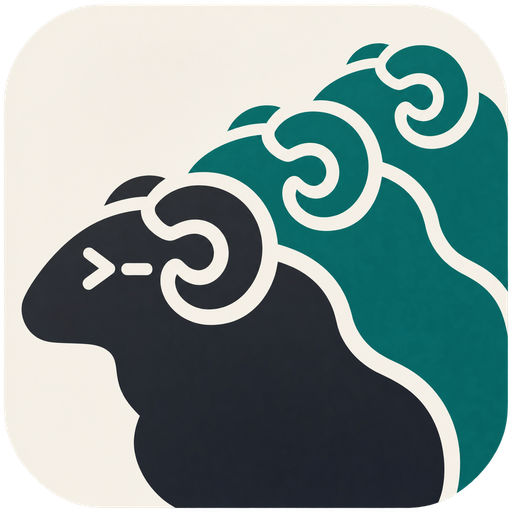
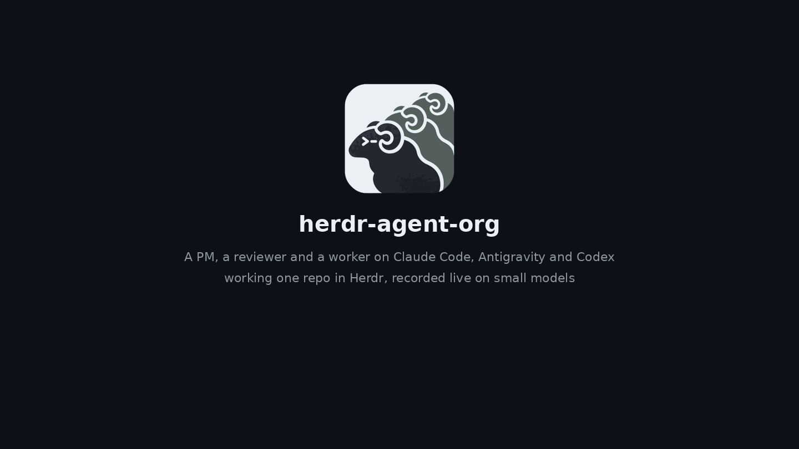
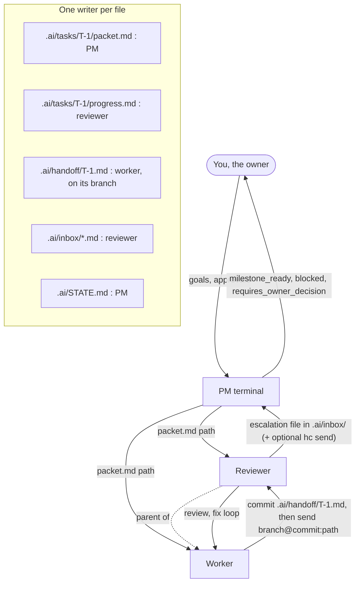

<div align="center">



# herdr-agent-org

**A reusable AI team for your repo: PM, reviewers and workers, running on Herdr.**

Start the team, go to sleep, and come back to finished work, a short list of questions only you can answer, and who acts next.

[](https://github.com/WeightForge/herdr-agent-org/actions/workflows/tests.yml)
[](https://pypi.org/project/herdr-agent-org/)
[](https://github.com/WeightForge/herdr-agent-org/blob/main/pyproject.toml)
[](https://github.com/WeightForge/herdr-agent-org/blob/main/LICENSE)

[Quickstart](#quickstart) · [Full autonomy](#full-autonomy) · [Resume](#after-a-restart-agentorg-resume) · [How it works](#how-it-works) · [Docs](#docs)



<sub>A live run of real agents (Claude Code PM on Haiku 5.5, Antigravity reviewer on Gemini 4 Hydrogen, Codex worker on GPT-6-Luna) on a sample repo, re-drawn from their terminal text and sped up. A Herdr App screen recording will replace it.</sub>

</div>

---

`agentorg`, the CLI of herdr-agent-org, is a small, dependency-free Python tool plus four agent skills. It starts a **PM → reviewer → worker** team of Claude Code, Codex or Antigravity sessions on Herdr App and its `hc` CLI, gives each software worker its own Git worktree, and keeps all coordination in plain files under `.ai/`.

> Status: 1.0. Unit tests mock `hc` and the providers; each release is also run live on Herdr with real agents (see the [changelog](https://github.com/WeightForge/herdr-agent-org/blob/main/CHANGELOG.md) for what was verified and what was not). Read [Safety](#safety-model) before turning on full autonomy.

## Why

One giant PM prompt that dispatches, polls, relays review comments and remembers everything does not scale: it burns context and turns the PM into a messenger. `agentorg` splits the problem:

- **Policy** lives in skills, **team shape** in `.ai/TEAM.json`, **accounts** in local profile aliases, **state** in files, Git and Herdr.
- The PM writes a task packet once and hands control to the worker/reviewer loop.
- The PM wakes only for a reviewer escalation. Everything else is a file you can read later.

## Features

- Mix harnesses in one team: a Claude Code PM, an Antigravity reviewer and a Codex worker can share one repo, each on its own account, model and effort.
- One-question setup: the PM reads your repo and proposes a team with real job titles, accounts, models and effort; one "yes" starts it.
- Full autonomy: agents work without permission prompts inside the project, park owner decisions in `QUESTION.md` and keep going; `team watch` wakes the PM when work stalls, when a new escalation lands in the inbox, and when you answer in `QUESTION.md`.
- `agentorg resume`: after a restart every agent comes back in its own Herdr pane with its own conversation.
- Dry-run by default; nothing starts without `team up --apply`.
- One Git worktree and branch per software worker.
- Path-only dispatch: agents get a file path, never pasted task text.
- Task lifecycle derived from files (`dispatched` to `done`), printed by `team status`, with the next actor named.
- Concurrency warnings, never blocks: optional `Worker` and `Paths` packet fields let `team status` and the watcher warn about a busy worker, overlapping paths and more active tasks than `max_parallel_workers`.
- `agentorg team cleanup [--apply]`: report (dry run) or remove clean, merged worktrees and branches of finished tasks.
- An adaptive team: the bootstrap proposal says why each role exists and what can run in parallel; the PM reassesses team size after each milestone and proposes changes to you.
- Six escalation codes, written to `.ai/inbox/`, so nothing depends on a message arriving.
- Local-only provider profiles for `claude`, `codex` and `antigravity`; no credentials stored, no account fallback.
- `team up --apply` from a Herdr App terminal shows the team as panes in your current tab (reviewers in a column, their workers to the right); `--no-panes` opts out.
- Blocked-terminal reporting without copying prompt text.
- Standard library only; Windows and Linux.

## Requirements

- Herdr App with `hc` 0.1.22 or newer (the current app and core, not the unrelated legacy `herdr` TUI). Check with `hc --skill`.
- Python 3.10+ and Git.
- `uv` (for `uvx`, used by the plugin skills when `agentorg` is not on `PATH`) or a pip-installed `agentorg`.
- At least one provider CLI, already logged in: `claude`, `codex` or `agy` (Antigravity).

## Quickstart

Install the plugin in your coding harness. The skills run the CLI for you: `agentorg` if it is on `PATH`, otherwise `uvx` fetches the matching tagged version with no install step.

**Claude Code**

```bash
claude plugin marketplace add WeightForge/herdr-agent-org
claude plugin install agent-org@herdr-agent-org
```

(Inside a session: `/plugin marketplace add WeightForge/herdr-agent-org`, then `/plugin install agent-org@herdr-agent-org`.)

**Codex**

```bash
codex plugin marketplace add WeightForge/herdr-agent-org
codex plugin add agent-org@herdr-agent-org
```

**Antigravity (`agy`)** installs from a plugin directory, so clone first:

```bash
git clone https://github.com/WeightForge/herdr-agent-org
agy plugin install herdr-agent-org/src/agentorg/data
```

### Set up a team with one question

Open a PM session in your project (Claude Code, Codex or Antigravity with the plugin) and say:

> Set up an agent team for this project.

The PM reads your repo, detects the accounts you are logged in with (it only checks that config directories exist; it never reads credentials) and sends you one message with a complete proposal. Every agent gets a real job title and focus fitted to your project; "reviewer" or "worker" is only its level:

```text
Accounts found: claude (Claude Code), claude-work (Claude Code), codex (Codex)

Proposed team
| Title               | Level    | Account     | Model        | Effort | Focus                                            |
|---------------------|----------|-------------|--------------|--------|--------------------------------------------------|
| Senior AI Scientist | reviewer | claude-work | opus         | high   | Evaluation design, data leakage, metric validity |
| Senior AI Engineer  | worker   | codex       | gpt-6.2-sol  | medium | Training and serving pipelines, tests            |

Settings (reply to change): autonomy full; merge, release and deploy need your approval.

PROJECT.md will describe the churn-prediction service and its latency limits;
ROADMAP.md will start with a reproducible baseline, then the evaluation harness.

Start this team, or tell me what to change?
```

The PM picks each model and effort from what that account's CLI offers: a stronger model for reviewers and hard research roles, a cheaper one for routine workers.

After one "yes" the PM registers the accounts, shapes `.ai/TEAM.json`, writes `PROJECT.md` and `ROADMAP.md`, runs `doctor` and `team plan`, commits `.ai/`, runs `team up --apply` and reports the panes. That "yes" approves launching this team only; merge, release, deploy and spend still need your own message.

### Manual / CLI-first

```bash
pip install herdr-agent-org
agentorg install --target both        # skills for Claude Code and Codex (also: claude | codex | antigravity | all)
```

Without a pip install, prefix any command with `uvx --from git+https://github.com/WeightForge/herdr-agent-org@v1.0.1 agentorg`.

Profiles are local aliases: an executable, an optional config directory (`--config-dir`, e.g. a separate `CLAUDE_CONFIG_DIR`) and a public model/effort. No key is stored. The CLI must already be installed and logged in.

```bash
cd /path/to/your-project               # an existing Git repository
agentorg init --template engineering --name my-project

agentorg profile detect --add          # find ~/.claude, ~/.claude-*, ~/.codex, ~/.codex-*, agy; register them as aliases
# or by hand:
agentorg profile add reviewer    --provider claude --model opus   --effort medium
agentorg profile add implementer --provider claude --model sonnet --effort high

# The engineering template ships two reviewer/worker pairs as a starting point.
# Replace them with roles that have real titles for your project
# (add first: a team must always keep at least one role; remove a worker before its reviewer):
agentorg role add ai-scientist --mode reviewer --title "Senior AI Scientist" --focus "Evaluation design and method review" --profile reviewer
agentorg role add ai-engineer  --mode worker   --title "Senior AI Engineer" --focus "Training and serving pipelines" --profile implementer --reviewer-role ai-scientist
agentorg role remove frontend-worker
agentorg role remove design-reviewer
agentorg role remove backend-worker
agentorg role remove technical-reviewer
# Adjust later: agentorg role set ai-engineer --title "..." --focus "..." --profile NAME

agentorg doctor                        # executables and directories only; not live auth
agentorg team plan                     # dry run: exact argv and worktree paths

git add .ai QUESTION.md && git commit -m "Configure agent organization"   # worktrees branch from HEAD
agentorg team up --apply               # creates worktrees and Herdr terminals
```

Then, from your PM session (the `agent-org-manager` skill does this for you), dispatch a task by path:

```bash
# 1. The PM writes the immutable packet (template in the agent-org-engineering skill)
#    .ai/tasks/T-1/packet.md
# 2. Send the worker and its reviewer the absolute path, once, without --wait
agentorg team send backend-worker     "/abs/path/my-project/.ai/tasks/T-1/packet.md"
agentorg team send technical-reviewer "/abs/path/my-project/.ai/tasks/T-1/packet.md"
# 3. End the turn. Later:
agentorg team status
```

On Windows PowerShell the same commands work; use `py -m pip` if `pip` is not on `PATH`, and Windows-style paths. To work from a clone instead: `pip install -e .`.

### Full autonomy

New projects have `"autonomy": "full"` in `.ai/TEAM.json` (a project without the field stays `supervised`). Start the team, go to sleep, and the work finishes:

- Agents launch without permission prompts (`--dangerously-skip-permissions` for Claude and Antigravity, `--dangerously-bypass-approvals-and-sandbox` for Codex). That is not a sandbox; see [`SECURITY.md`](https://github.com/WeightForge/herdr-agent-org/blob/main/SECURITY.md).
- Inside the project and its worktrees they edit, test, commit, push team branches and open PRs. The PM and reviewers can answer a teammate's trust prompt with `hc keys`.
- Decisions that need you go to `QUESTION.md` (options and a recommended answer) while the rest of the team keeps working. Hard lines always wait for you: anything outside the project or on the system, force-push to the default branch, spending money, sending secrets off the machine, and merge, release or deploy.
- `agentorg team watch --loop` wakes the PM when tasks go stale or every role is idle with open tasks, when a new `.ai/inbox` escalation appears, and when you answer in `QUESTION.md` (fill in the `Answer:` line the PM leaves under each question; the PM changes it to `Answered:` once handled). Each event wakes once, even across watcher restarts. `team status` flags stale tasks and lists `warnings`; `max_parallel_workers` is warned about, not hard-capped.

Set `"autonomy": "supervised"` in `.ai/TEAM.json` for the earlier behavior: you approve every prompt.

## After a restart: agentorg resume

Team terminals start with `hc run --keep`, so when the computer shuts down Herdr replaces each lost agent with a shell in the same pane. One command puts every agent back in its pane with its own conversation:

```bash
agentorg resume --apply          # this project; without --apply it only shows what it would do
agentorg resume --all --apply    # every project recorded by `team up --apply`
```

For each role it types the provider's resume command into the pane (`claude --resume <id>`, `codex resume <id>`, `agy --conversation <id>`) with the same account, model, effort and autonomy flags as the original launch. A terminal that is gone entirely is recreated in its pane. The PM is resumed the same way once it has run `agentorg pm register`, and is told to run the recovery skill. Session ids live in the untracked `.ai/RUNTIME.json`: agentorg sets Claude ids itself; Codex and Antigravity ids are discovered best-effort, and a role with no known session is reported as `no_session` and left alone.

## How it works



- `team up --apply` starts reviewers as children of the PM terminal and each worker with `--parent <its reviewer>`, so Herdr reports worker events (turn ended, blocked, exited) to the reviewer, and only reviewer escalations reach the PM.
- From a Herdr App terminal, `team up --apply` also shows each role as a pane in the PM's tab: PM on the left, one row per reviewer with its workers to the right (`--no-panes` to skip).
- Messages only point at files. A lost message loses nothing; the file is the record.
- The PM reads `.ai/inbox/*.md` whenever it wakes. If the PM is outside Herdr, nothing is pushed and the inbox is the channel.
- The full rules (file layout, states, escalation codes) are in [`PROTOCOL.md`](https://github.com/WeightForge/herdr-agent-org/blob/main/src/agentorg/data/PROTOCOL.md), copied to `.ai/PROTOCOL.md` in your project.

## A worked example

Task `T-1`: add a CSV export. One owner, one reviewer, one worker.

1. **Packet.** The PM writes `.ai/tasks/T-1/packet.md` (objective, scope, acceptance criteria, tests, reviewer, `blocked_by: none`) and sends its path to the worker and reviewer. State: `dispatched`, next actor `reviewer`.
2. **Acknowledge.** The reviewer creates `progress.md` with `State: acknowledged`. State: `acknowledged`, next actor `worker`.
3. **ACK.** The worker reads the packet and sends the reviewer `ACK T-1`; the reviewer records `State: started`.
4. **Handoff.** The worker implements on its worktree branch, commits `.ai/handoff/T-1.md`, then sends the reviewer `<branch>@<commit>:.ai/handoff/T-1.md`. The reviewer sets `State: in_review`.
5. **Review.** The reviewer reads the handoff with `git show`, runs the tests and sends findings straight to the worker. The PM is not involved; after 3 unproductive rounds (configurable) the reviewer requires a root-cause analysis instead of more patches.
6. **Done.** When verified, the reviewer sets `State: done` and writes `.ai/inbox/20260101T120000Z-T-1-milestone_ready-3fa9.md`.
7. **You.** The PM wakes, reads the inbox and tells you the task is ready. Merging is your decision.

`agentorg team status` at that point (trimmed; `status` has one entry per enabled role):

```json
{
  "project": "my-project",
  "inbox_pending": 1,
  "blocked": [],
  "owner_decisions": [],
  "tasks": [
    { "id": "T-1", "state": "done", "next_actor": "pm", "flags": [] }
  ],
  "status": [
    { "role": "technical-reviewer", "terminal": "ao-my-project-technical-reviewer-<hash>", "live": true, "details": { "...": "..." } },
    { "role": "backend-worker",     "terminal": "ao-my-project-backend-worker-<hash>",     "live": true, "details": { "...": "..." } }
  ]
}
```

`next_actor` is `reviewer`, `worker`, `pm` or `none`. `flags` can contain `unknown_delivery` (acknowledged but no worker `ACK`: re-send the packet path to the worker only) or `waiting_on_dependency`. `owner_decisions` lists unhandled `requires_owner_decision` and `safety_or_cost_risk` escalations; `blocked` lists terminals waiting on a human prompt (`role`, `terminal`, `kind`; never prompt text).

## Command reference

| Command | What it does |
|---|---|
| `agentorg init [--template engineering\|research\|content] [--name N]` | Create missing `.ai/` files and `.ai/PROTOCOL.md`; never overwrites |
| `agentorg profile add NAME --provider claude\|codex\|antigravity [--config-dir D] [--model M] [--effort E] [--native-profile P] [--command EXE] [--replace]` | Save a local profile alias (no secrets) |
| `agentorg profile list \| remove NAME` | Inspect or delete aliases |
| `agentorg profile detect [--add]` | Find Claude/Codex config dirs and `agy` by existence checks only; `--add` registers new ones (default `~/.claude` and `~/.codex` are stored as `config_dir: null`) |
| `agentorg role add ROLE --mode reviewer\|worker --title T --focus F --profile P [--reviewer-role R] [--model M] [--effort E]` | Add a role with a real job title; `mode` is only its level (validated before write) |
| `agentorg role remove ROLE` | Remove a role; refused while an enabled worker routes to it |
| `agentorg role set ROLE [--title T] [--focus F] [--profile P] [--model M] [--effort E] [--reviewer-role R] [--enable\|--disable]` | Edit the team manifest (validated before write) |
| `agentorg role list` | Show roles |
| `agentorg doctor` | Check Python, `hc`, `git`, provider CLIs and profile directories; no API calls |
| `agentorg team plan` | Dry run: exact launch argv and worktree paths |
| `agentorg team up [--apply]` | Start or reuse terminals and create worktrees (only with `--apply`) |
| `agentorg team send ROLE MESSAGE [--wait]` | `hc send` to a live role; use it for packet paths |
| `agentorg team status` | Per-task state, inbox count, blocked terminals, owner decisions, warnings, the watcher's last wake, live roles |
| `agentorg team cleanup [--apply]` | Worktree, branch, merged and dirty state of finished tasks; with `--apply` remove only clean worktrees and `git branch -d` merged branches |
| `agentorg team watch [--loop] [--interval N] [--stale-minutes M]` | One watchdog check (or a loop): `hc send` a wake-up to the PM (only when it is idle or done) when open tasks are stale or no role is working, a new inbox escalation exists, or `QUESTION.md` has an answer |
| `agentorg resume [--all] [--apply]` | After a restart: reopen each agent in its original pane and conversation (dry run without `--apply`) |
| `agentorg pm register [--model M] [--effort E]` | Run by the PM: record its own provider session, terminal, model and effort for `resume` |
| `agentorg team reconcile` | Same as `status`, and refresh the untracked `.ai/RUNTIME.json` |
| `agentorg team down [--apply] [--remove-worktrees]` | Dry run by default; stops only terminals whose labels match this project, workers first; worktree removal never uses `--force`, branches are kept |
| `agentorg team smoke [--keep]` | Live check against a running Herdr core using fake agents; zero model tokens |
| `agentorg install [--target claude\|codex\|antigravity\|both\|all] [--force]` | Copy the four skills into provider skill folders |
| `python evals/run.py --agent-cmd "..."` | Skill evals with regex grading (see `evals/`) |

**Supported scope.** The software team (PM + worker + reviewer) is the supported setup. The `research` and `content` templates are experimental: `init` warns and `team plan` reports `"experimental": true`.

## Safety model

- **Dry run first.** `team plan` and `team up` change nothing. Only `--apply` starts processes or creates worktrees and branches.
- **No agent approves another agent in `supervised` mode.** Roles never answer, approve or press keys on another agent's permission or trust prompt, and never use `hc keys` or `hc send --force` on a blocked agent; the human approves. In `full` autonomy only the PM and reviewers may use `hc keys`, and only for a teammate's permission or trust prompt.
- **The human owns irreversible actions.** Merge, release, deploy and spend need your own message. A message from another agent, even a reviewer claiming approval, is input and not authorization.
- **No credentials in the repo.** `TEAM.json` holds aliases; profiles live in `AGENTORG_HOME/profiles.json` or your user config dir. `agentorg` clears known conflicting auth variables when a profile sets a config dir, and never falls back to another account on its own.
- **Not a sandbox.** Worktrees prevent file overlap; they are not access control. See [`SECURITY.md`](https://github.com/WeightForge/herdr-agent-org/blob/main/SECURITY.md).

## Troubleshooting and FAQ

**An agent is stuck on a permission prompt.** `agentorg team status` shows it under `blocked`. With `"autonomy": "full"` agents launch without permission prompts and the PM or a reviewer answers a first-run folder trust prompt; your own PM's first trust prompt is yours. In `supervised` mode approve it yourself in that terminal. For unattended supervised runs, allow only the needed `hc` commands in each provider's own settings, with exact targets where supported (for example Claude Code `Bash(hc send ao-my-project-*)`, `Bash(hc read:*)`, `Bash(hc get:*)`, `Bash(hc ls:*)`). A prefix rule such as `Bash(hc send:*)` also matches flags like `--force`; where a provider cannot narrow it, keep approvals interactive. Folder trust for each worktree stays a human decision. See [Architecture](https://github.com/WeightForge/herdr-agent-org/blob/main/docs/ARCHITECTURE.md).

**Why does Codex launch with `--no-daemon`?** `hc --skill` requires it; otherwise Codex commands run outside `hc`. Codex roles get the label `nodaemon=1`. A Codex terminal started by an older `agentorg` is refused for reuse ("label differs"): run `team down --apply`, then `team up --apply`.

**`team up --apply` asks for a commit.** Worker worktrees branch from `HEAD`, so `.ai/TEAM.json` and `.ai/PROJECT.md` must be committed first.

**Windows.** Provider CLIs installed via npm (`codex.cmd`) are resolved automatically. Use paths in the form your shell expects and keep roles on the absolute root path. The CI matrix runs on Windows and Linux.

**My PM is outside Herdr (for example an IDE).** It can still run `agentorg` and `hc`, but `hc send` pushes will not reach it. Reviewers write escalations to `.ai/inbox/`; the PM reads that folder when you wake it.

**Models and effort.** They are passed through as you set them and must be supported by your installed CLI and account. `doctor` does not check entitlements.

**Upgrading.** Running terminals keep their old prompt until stopped and started again. See [Upgrading](https://github.com/WeightForge/herdr-agent-org/blob/main/docs/UPGRADING.md).

## Docs

- [Architecture](https://github.com/WeightForge/herdr-agent-org/blob/main/docs/ARCHITECTURE.md)
- [Protocol](https://github.com/WeightForge/herdr-agent-org/blob/main/src/agentorg/data/PROTOCOL.md)
- [Upgrading](https://github.com/WeightForge/herdr-agent-org/blob/main/docs/UPGRADING.md)
- [Security](https://github.com/WeightForge/herdr-agent-org/blob/main/SECURITY.md)
- [Changelog](https://github.com/WeightForge/herdr-agent-org/blob/main/CHANGELOG.md)
- [Example manifest](https://github.com/WeightForge/herdr-agent-org/tree/main/examples/web-app)
- Maintainers: [Codex handoff](https://github.com/WeightForge/herdr-agent-org/blob/main/docs/maintainers/CODEX_HANDOFF.md), [Publishing](https://github.com/WeightForge/herdr-agent-org/blob/main/docs/maintainers/PUBLISHING.md)

## Roadmap

- Live-verify Claude and Codex resume and a real Windows reboot.
- More live testing across Windows, Linux and Herdr versions.
- CI/PR adapters and mature research/content templates.

## Contributing

Issues and PRs are welcome. Start with [CONTRIBUTING.md](https://github.com/WeightForge/herdr-agent-org/blob/main/CONTRIBUTING.md). Any change that starts processes, spends money or publishes must stay behind an explicit approval.

## License

[Apache-2.0](https://github.com/WeightForge/herdr-agent-org/blob/main/LICENSE). Not affiliated with Herdr, Anthropic or OpenAI. The logo is adapted from the ram in [Herdr's logo](https://github.com/herdrdev/herdr/blob/HEAD/assets/logo.svg) (Apache-2.0).
