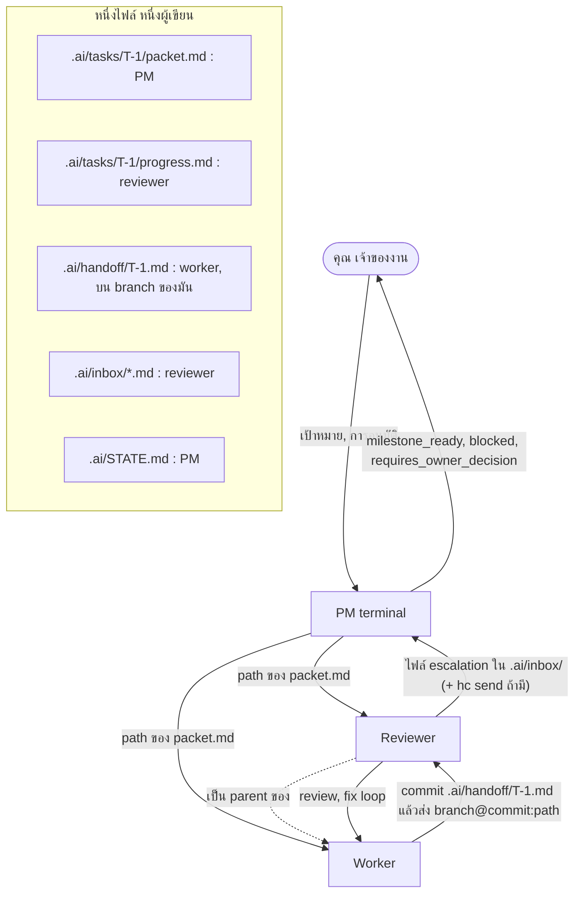

<div align="center">

# agentorg

**ทีม AI ที่ใช้ซ้ำได้สำหรับ repo ของคุณ: PM, reviewer และ worker ทำงานบน Herdr**

PM ไม่ต้องคอยเฝ้า: worker และ reviewer ทำงานจนเสร็จ แล้วคุณกลับมาดูว่าเกิดอะไรขึ้นและใครต้องทำอะไรต่อ

[](https://github.com/WeightForge/herdr-agent-org/actions/workflows/tests.yml)
[](https://pypi.org/project/herdr-agent-org/)
[](https://github.com/WeightForge/herdr-agent-org/blob/main/pyproject.toml)
[](https://github.com/WeightForge/herdr-agent-org/blob/main/LICENSE)

[Quickstart](#quickstart) · [How it works](#how-it-works) · [Docs](#docs) · [Contributing](#contributing)

[English](https://github.com/WeightForge/herdr-agent-org/blob/main/README.md) · ภาษาไทย

</div>

---

`agentorg` คือ Python CLI ขนาดเล็กที่ไม่มี dependency พร้อม skill สำหรับ agent 4 ตัว ใช้เปิดทีม **PM → reviewer → worker** จาก session ของ Claude Code, Codex หรือ Antigravity บน Herdr App และ CLI `hc` โดย worker สาย software แต่ละตัวได้ Git worktree ของตัวเอง และการประสานงานทั้งหมดเก็บเป็นไฟล์ธรรมดาใน `.ai/`

> สถานะ: ก่อน 1.0 unit test ใช้ mock ส่วนคำสั่ง `team smoke` ทดสอบกับ Herdr core ที่รันจริงโดยใช้ fake agent ให้ใช้อย่างระมัดระวังและอ่าน [Safety model](#safety-model) ก่อน

## Why

Prompt PM ก้อนใหญ่ที่ต้องสั่งงาน คอยถามสถานะ ส่งต่อคอมเมนต์รีวิว และจำทุกอย่างเอง ไม่สเกล: กิน context และทำให้ PM กลายเป็นคนส่งข่าว `agentorg` แยกปัญหาออกเป็นส่วน ๆ:

- **นโยบาย** อยู่ใน skill, **รูปแบบทีม** อยู่ใน `.ai/TEAM.json`, **บัญชี** อยู่ใน profile alias บนเครื่อง, **สถานะ** อยู่ในไฟล์, Git และ Herdr
- PM เขียน task packet ครั้งเดียว แล้วส่งต่อให้ลูปของ worker/reviewer
- PM ถูกปลุกเฉพาะเมื่อ reviewer escalate เรื่องอื่นทั้งหมดเป็นไฟล์ที่เปิดอ่านย้อนหลังได้

## Features

- Dry-run เป็นค่าเริ่มต้น ไม่มีอะไรเริ่มทำงานถ้าไม่มี `team up --apply`
- หนึ่ง Git worktree และ branch ต่อ software worker หนึ่งตัว
- Dispatch ด้วย path เท่านั้น: agent ได้รับ path ของไฟล์ ไม่ใช่ข้อความงานที่แปะมา
- สถานะ task คำนวณจากไฟล์ (`dispatched` ถึง `done`) แสดงด้วย `team status` และบอกว่าใครต้องทำต่อ
- Escalation 6 code เขียนลง `.ai/inbox/` จึงไม่ต้องพึ่งว่าข้อความจะส่งถึง
- Provider profile เก็บบนเครื่องเท่านั้น สำหรับ `claude`, `codex` และ `antigravity` ไม่เก็บ credential และไม่สลับบัญชีเอง
- รายงาน terminal ที่ติดอยู่โดยไม่คัดลอกข้อความ prompt
- ใช้เฉพาะ standard library รองรับ Windows และ Linux

## Requirements

- Herdr App พร้อม `hc` เวอร์ชัน 0.1.22 ขึ้นไป (ตัวปัจจุบัน ไม่ใช่ `herdr` TUI รุ่นเก่าที่ไม่เกี่ยวกัน) ตรวจด้วย `hc --skill`
- Python 3.10+ และ Git
- Provider CLI อย่างน้อยหนึ่งตัวที่ login ไว้แล้ว: `claude`, `codex` หรือ `agy` (Antigravity)

## Quickstart

```bash
pip install herdr-agent-org
agentorg install --target both        # skill สำหรับ Claude Code และ Codex (ตัวเลือกอื่น: claude | codex | antigravity | all)

cd /path/to/your-project               # Git repository ที่มีอยู่แล้ว
agentorg init --template engineering --name my-project
```

Profile คือ alias บนเครื่อง ประกอบด้วย executable, config directory (ไม่บังคับ, `--config-dir` เช่น `CLAUDE_CONFIG_DIR` แยกบัญชี) และ model/effort ที่เป็นข้อมูลสาธารณะ ไม่เก็บ key ใด ๆ CLI ต้องติดตั้งและ login ไว้ก่อน

```bash
agentorg profile add reviewer    --provider claude --model opus   --effort medium
agentorg profile add implementer --provider claude --model sonnet --effort high

# template engineering มาพร้อม reviewer/worker 2 คู่ ผูกกับ alias
# reviewer, implementer, designer และ frontend ใน quickstart นี้ใช้คู่เดียว:
agentorg role set frontend-worker --disable
agentorg role set design-reviewer --disable
# ถ้าอยากผูก role กับ alias อื่น: agentorg role set backend-worker --profile NAME

agentorg doctor                        # ตรวจ executable และ directory เท่านั้น ไม่ได้ตรวจ login จริง
agentorg team plan                     # dry run: แสดง argv และ path ของ worktree

git add .ai QUESTION.md && git commit -m "Configure agent organization"   # worktree แตกจาก HEAD
agentorg team up --apply               # สร้าง worktree และ Herdr terminal
```

จากนั้นจาก session ของ PM (skill `agent-org-manager` ทำส่วนนี้ให้) สั่งงานด้วย path:

```bash
# 1. PM เขียน packet ที่แก้ไขไม่ได้ (template อยู่ใน skill agent-org-engineering)
#    .ai/tasks/T-1/packet.md
# 2. ส่ง absolute path ให้ worker และ reviewer ของมัน ครั้งเดียว ไม่ใช้ --wait
agentorg team send backend-worker     "/abs/path/my-project/.ai/tasks/T-1/packet.md"
agentorg team send technical-reviewer "/abs/path/my-project/.ai/tasks/T-1/packet.md"
# 3. จบ turn แล้วค่อยกลับมาดู:
agentorg team status
```

บน Windows PowerShell ใช้คำสั่งเดียวกันได้ ใช้ `py -m pip` ถ้า `pip` ไม่อยู่ใน `PATH` และใช้ path แบบ Windows ถ้าต้องการรันจาก clone: `pip install -e .`

## How it works



- `team up --apply` เปิด reviewer เป็นลูกของ PM terminal และเปิด worker แต่ละตัวด้วย `--parent <reviewer ของมัน>` ดังนั้น Herdr แจ้งเหตุการณ์ของ worker (จบ turn, blocked, exited) ไปที่ reviewer และมีเพียง escalation ของ reviewer เท่านั้นที่ถึง PM
- ข้อความแค่ชี้ไปที่ไฟล์ ข้อความหายก็ไม่เสียอะไร เพราะไฟล์คือบันทึกจริง
- PM อ่าน `.ai/inbox/*.md` ทุกครั้งที่ตื่น ถ้า PM อยู่นอก Herdr จะไม่มีอะไรถูก push และ inbox คือช่องทางหลัก
- กฎทั้งหมด (โครงสร้างไฟล์, state, escalation code) อยู่ใน [`PROTOCOL.md`](https://github.com/WeightForge/herdr-agent-org/blob/main/src/agentorg/data/PROTOCOL.md) ซึ่งถูกคัดลอกเป็น `.ai/PROTOCOL.md` ในโปรเจกต์ของคุณ

## A worked example

Task `T-1`: เพิ่มการ export CSV มีเจ้าของ 1 คน reviewer 1 ตัว worker 1 ตัว

1. **Packet** PM เขียน `.ai/tasks/T-1/packet.md` (objective, scope, acceptance criteria, tests, reviewer, `blocked_by: none`) แล้วส่ง path ให้ worker และ reviewer state: `dispatched`, next actor คือ `reviewer`
2. **Acknowledge** Reviewer สร้าง `progress.md` ที่มี `State: acknowledged` state: `acknowledged`, next actor คือ `worker`
3. **ACK** Worker อ่าน packet แล้วส่ง `ACK T-1` ให้ reviewer ซึ่งบันทึก `State: started`
4. **Handoff** Worker ทำงานบน branch ของ worktree, commit `.ai/handoff/T-1.md` แล้วส่ง `<branch>@<commit>:.ai/handoff/T-1.md` ให้ reviewer ซึ่งตั้ง `State: in_review`
5. **Review** Reviewer อ่าน handoff ด้วย `git show`, รัน test และส่งข้อเสนอแนะให้ worker โดยตรง PM ไม่เกี่ยว ถ้ารอบที่ไม่เกิดผลครบ 3 ครั้ง (ตั้งค่าได้) reviewer จะบังคับให้ทำ root-cause analysis แทนการแก้แบบปะผุต่อ
6. **Done** เมื่อตรวจผ่าน reviewer ตั้ง `State: done` และเขียน `.ai/inbox/20260101T120000Z-T-1-milestone_ready-3fa9.md`
7. **คุณ** PM ตื่นมาอ่าน inbox แล้วแจ้งคุณว่างานพร้อม การ merge เป็นการตัดสินใจของคุณ

`agentorg team status` ณ จุดนั้น (ตัดให้สั้น; `status` มีหนึ่งรายการต่อ role ที่เปิดใช้งาน):

```json
{
  "project": "my-project",
  "inbox_pending": 1,
  "blocked": [],
  "owner_decisions": [],
  "tasks": [
    { "id": "T-1", "state": "done", "next_actor": "pm", "flags": [] }
  ],
  "status": [
    { "role": "technical-reviewer", "terminal": "ao-my-project-technical-reviewer-<hash>", "live": true, "details": { "...": "..." } },
    { "role": "backend-worker",     "terminal": "ao-my-project-backend-worker-<hash>",     "live": true, "details": { "...": "..." } }
  ]
}
```

`next_actor` เป็น `reviewer`, `worker`, `pm` หรือ `none` ส่วน `flags` อาจมี `unknown_delivery` (acknowledged แล้วแต่ยังไม่มี `ACK` จาก worker: ส่ง path ของ packet ให้ worker อีกครั้ง เฉพาะ worker) หรือ `waiting_on_dependency` ส่วน `owner_decisions` แสดง escalation `requires_owner_decision` และ `safety_or_cost_risk` ที่ยังไม่ได้จัดการ และ `blocked` แสดง terminal ที่รอ prompt จากมนุษย์ (`role`, `terminal`, `kind` ไม่มีข้อความ prompt)

## Command reference

| Command | ทำอะไร |
|---|---|
| `agentorg init [--template engineering\|research\|content] [--name N]` | สร้างไฟล์ `.ai/` และ `.ai/PROTOCOL.md` ที่ยังไม่มี ไม่เขียนทับ |
| `agentorg profile add NAME --provider claude\|codex\|antigravity [--config-dir D] [--model M] [--effort E] [--native-profile P] [--command EXE] [--replace]` | บันทึก profile alias บนเครื่อง (ไม่มี secret) |
| `agentorg profile list \| remove NAME` | ดูหรือลบ alias |
| `agentorg role set ROLE [--profile P] [--model M] [--effort E] [--reviewer-role R] [--enable\|--disable]` | แก้ manifest ของทีม (ตรวจก่อนเขียน) |
| `agentorg role list` | แสดง role |
| `agentorg doctor` | ตรวจ Python, `hc`, `git`, provider CLI และ directory ของ profile ไม่เรียก API |
| `agentorg team plan` | Dry run: แสดง argv ที่ใช้เปิดและ path ของ worktree |
| `agentorg team up [--apply]` | เปิดหรือใช้ terminal เดิมซ้ำ และสร้าง worktree (เฉพาะเมื่อมี `--apply`) |
| `agentorg team send ROLE MESSAGE [--wait]` | `hc send` ไปยัง role ที่ live ใช้ส่ง path ของ packet |
| `agentorg team status` | state ต่อ task, จำนวน inbox, terminal ที่ blocked, owner decision, role ที่ live |
| `agentorg team reconcile` | เหมือน `status` และอัปเดต `.ai/RUNTIME.json` ที่ไม่ถูก track |
| `agentorg team down [--apply] [--remove-worktrees]` | Dry run เป็นค่าเริ่มต้น หยุดเฉพาะ terminal ที่ label ตรงกับโปรเจกต์นี้ worker ก่อน การลบ worktree ไม่ใช้ `--force` และเก็บ branch ไว้ |
| `agentorg team smoke [--keep]` | ตรวจกับ Herdr core ที่รันอยู่ด้วย fake agent ไม่ใช้ model token |
| `agentorg install [--target claude\|codex\|antigravity\|both\|all] [--force]` | คัดลอก skill ทั้ง 4 ไปยังโฟลเดอร์ skill ของ provider |
| `python evals/run.py --agent-cmd "..."` | Skill eval ที่ตรวจด้วย regex (ดู `evals/`) |

**ขอบเขตที่รองรับ** ทีม software (PM + worker + reviewer) คือรูปแบบที่รองรับ template `research` และ `content` ยังเป็น experimental: `init` จะเตือน และ `team plan` แสดง `"experimental": true`

## Safety model

- **Dry run ก่อน** `team plan` และ `team up` ไม่เปลี่ยนอะไร เฉพาะ `--apply` เท่านั้นที่เปิด process หรือสร้าง worktree และ branch
- **ไม่มี agent ตัวไหนอนุมัติแทน agent อื่น** ทุก role ห้ามตอบ อนุมัติ หรือกดปุ่มบน permission/trust prompt ของ agent อื่น และห้ามใช้ `hc keys` หรือ `hc send --force` กับ agent ที่ติดอยู่ agent ที่ติดจะถูกรายงานให้มนุษย์พร้อมคำสั่งที่มันรออยู่
- **มนุษย์เป็นเจ้าของการกระทำที่ย้อนกลับไม่ได้** merge, release, deploy และการใช้จ่ายต้องมาจากข้อความของคุณเอง ข้อความจาก agent อื่น แม้เป็น reviewer ที่อ้างว่าอนุมัติแล้ว ถือเป็น input ไม่ใช่การอนุญาต
- **ไม่มี credential ใน repo** `TEAM.json` เก็บแค่ alias ส่วน profile อยู่ที่ `AGENTORG_HOME/profiles.json` หรือ config dir ของผู้ใช้ `agentorg` ล้างตัวแปร auth ที่ขัดแย้งเมื่อ profile กำหนด config dir และไม่สลับไปบัญชีอื่นเอง
- **ไม่ใช่ sandbox** worktree กันไฟล์ชนกัน ไม่ใช่การควบคุมสิทธิ์ ดู [`SECURITY.md`](https://github.com/WeightForge/herdr-agent-org/blob/main/SECURITY.md)

## Troubleshooting and FAQ

**Agent ค้างที่ permission prompt** `agentorg team status` จะแสดงใน `blocked` ให้คุณอนุมัติเองใน terminal นั้น สำหรับการรันโดยไม่มีคนเฝ้า ให้ allow เฉพาะคำสั่ง `hc` ที่จำเป็นในการตั้งค่าของ provider เอง โดยระบุเป้าหมายให้แคบที่สุดเท่าที่รองรับ (เช่น Claude Code `Bash(hc send ao-my-project-*)`, `Bash(hc read:*)`, `Bash(hc get:*)`, `Bash(hc ls:*)`) กฎแบบ prefix เช่น `Bash(hc send:*)` จะตรงกับ flag อย่าง `--force` ด้วย ถ้า provider จำกัดไม่ได้ ให้คงการอนุมัติแบบ interactive การเชื่อใจโฟลเดอร์ (folder trust) ของแต่ละ worktree ยังเป็นการตัดสินใจของมนุษย์ ดู [Architecture](https://github.com/WeightForge/herdr-agent-org/blob/main/docs/ARCHITECTURE.md)

**ทำไม Codex เปิดด้วย `--no-daemon`** `hc --skill` กำหนดไว้ ไม่เช่นนั้นคำสั่งของ Codex จะรันนอก `hc` role ของ Codex จะมี label `nodaemon=1` terminal ของ Codex ที่เปิดโดย `agentorg` รุ่นเก่าจะไม่ถูกนำกลับมาใช้ ("label differs"): รัน `team down --apply` แล้ว `team up --apply` ใหม่

**`team up --apply` ให้ commit ก่อน** worktree ของ worker แตกจาก `HEAD` จึงต้อง commit `.ai/TEAM.json` และ `.ai/PROJECT.md` ก่อน

**Windows** CLI ที่ติดตั้งผ่าน npm (`codex.cmd`) ถูกหาให้อัตโนมัติ ใช้ path ในรูปแบบที่ shell ของคุณคาดหวัง และให้ role ใช้ absolute path ของ root เสมอ CI รันทั้ง Windows และ Linux

**PM ของฉันอยู่นอก Herdr (เช่น IDE)** ยังรัน `agentorg` และ `hc` ได้ แต่ `hc send` จะไม่ push เข้าถึง PM Reviewer เขียน escalation ลง `.ai/inbox/` และ PM อ่านโฟลเดอร์นั้นเมื่อคุณปลุก

**Model และ effort** ส่งต่อตามที่ตั้งไว้ และต้องรองรับโดย CLI และบัญชีของคุณ `doctor` ไม่ตรวจสิทธิ์การใช้ model

**การอัปเกรด** terminal ที่กำลังรันจะใช้ prompt เดิมจนกว่าจะหยุดแล้วเปิดใหม่ ดู [Upgrading](https://github.com/WeightForge/herdr-agent-org/blob/main/docs/UPGRADING.md)

## Docs

- [Architecture](https://github.com/WeightForge/herdr-agent-org/blob/main/docs/ARCHITECTURE.md)
- [Protocol](https://github.com/WeightForge/herdr-agent-org/blob/main/src/agentorg/data/PROTOCOL.md)
- [Upgrading](https://github.com/WeightForge/herdr-agent-org/blob/main/docs/UPGRADING.md)
- [Security](https://github.com/WeightForge/herdr-agent-org/blob/main/SECURITY.md)
- [Changelog](https://github.com/WeightForge/herdr-agent-org/blob/main/CHANGELOG.md)
- [Example manifest](https://github.com/WeightForge/herdr-agent-org/tree/main/examples/layerdelta)
- สำหรับ maintainer: [Codex handoff](https://github.com/WeightForge/herdr-agent-org/blob/main/docs/maintainers/CODEX_HANDOFF.md), [Publishing](https://github.com/WeightForge/herdr-agent-org/blob/main/docs/maintainers/PUBLISHING.md)

## Roadmap

- Watcher แบบ event-driven พร้อม checkpoint ถาวร (ตอนนี้ PM ถูกปลุกจาก escalation ของ reviewer และ note ของ `hc` ไม่มี supervisor ทำงานเบื้องหลัง)
- ทดสอบกับระบบจริงให้ครอบคลุม Windows, Linux และ Herdr หลายเวอร์ชัน
- บังคับใช้ `max_parallel_workers` (ตอนนี้เป็นนโยบายของ PM ไม่ใช่เพดานจำนวน process)
- CI/PR adapter และ template research/content ที่สมบูรณ์ขึ้น

## Contributing

ยินดีรับ issue และ PR เริ่มที่ [CONTRIBUTING.md](https://github.com/WeightForge/herdr-agent-org/blob/main/CONTRIBUTING.md) การเปลี่ยนแปลงใดที่เปิด process ใช้เงิน หรือ publish ต้องอยู่หลังการอนุมัติที่ชัดเจนเสมอ

## License

[Apache-2.0](https://github.com/WeightForge/herdr-agent-org/blob/main/LICENSE) ไม่มีส่วนเกี่ยวข้องกับ Herdr, Anthropic หรือ OpenAI
